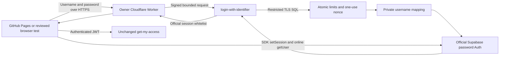

# Public username login architecture — proposal, not activated

## Managed-role precondition correction

The owner verified normal permanent owner memberships granted by supabase_admin (ADMIN true, INHERIT/SET false) and confirmed pg_cron is not installed. The [corrected role-grant runbook](SUPABASE_MANAGED_ROLE_PROPOSALS.md) supersedes the earlier blanket membership rejection. Reviewed SQL now preserves those rows, uses explicitly self-granted temporary SET privileges and verifies cleanup/ownership/ACLs before commit. Read-only 03 must be checked before and after approved 00/01 transactions; Cron installation remains a separate approval. No live SQL or activation is performed by this correction.

## Worker runtime correction

The owner created the disabled Worker `taxiqaid-auth-gateway` and reported a Dashboard Fetch type incompatibility. The [compatibility correction](CLOUDFLARE_WORKER_COMPATIBILITY.md) removes the browser-only credentials option, uses manual redirects with explicit denial and records official-type/local-workerd validation. It changes no live Worker variable, Supabase setting or activation state. Use the newly regenerated Worker artifact for review rather than the original `b8a033f` artifact.

Review date: 2026-11-12. Continue `feat/dedicated-supabase-auth`. No deployment, secret edit, live SQL, login enablement, main merge or branch deletion is authorized. Production GitHub Pages and the old external Supabase project remain unchanged.

## Owner-verified state

The genuine **private** username diagnostic passed all checks: `dohanyan`, official password Auth, private mapping/UID, active Master, deployed `get-my-access` compatibility, 101/101 management grants, six/six Driver denials, session creation/sign-out, PostgreSQL connectivity and TLS. The owner deleted `check-owner-username` and its three settings. Only `get-my-access` and disabled `login-with-identifier` remain deployed. Do not repeat/recreate the private diagnostic or describe its PASS as a public-handler/browser PASS.

Native settings remain unchanged: sign-up/sign-in 30/5 minutes/IP; password/refresh token endpoint 150/5 minutes/IP; OTP verification 30/5 minutes/IP; anonymous sign-in 30/hour/IP; IP forwarding disabled. ES256, accounts, mappings, departments, 107 definitions and 101 Master grants are preserved. No MFA/challenge, driver admission, service-role key or replacement Auth identity is introduced.

## Recommendation and alternatives

Use an owner-controlled **Cloudflare Worker Free gateway**, a cryptographically authenticated Worker→Supabase hop, the real deployed **login-with-identifier** handler, and existing restricted SQL/Auth/session/access logic. GitHub Pages remains the static website. Only username credential requests go through the Worker; SDK user verification, access and logout retain the dedicated Supabase URL. This needs a Cloudflare account but no custom domain, installed software or answered Supabase Support ticket. It adds a credential-processing provider/account and a narrow server-to-server HMAC secret; the owner must approve that boundary before deployment.

| Alternative | Practical benefit | Security/operational limit | Recommendation |
| --- | --- | --- | --- |
| Direct Supabase, atomic global + identifier limits | Simplest Free/browser-only operation; independent of IP provenance | No trustworthy per-source limit; one actor can exhaust global/account budgets; direct native Auth remains separate | Possible only after explicit acceptance of that different boundary; not implemented as a silent fallback |
| Direct Supabase, supplied forwarded-IP header | Few components | No established hosted provenance; a flag is not proof | Reject |
| Cloudflare DNS/custom-domain proxy alone | Convenient routing/WAF options | Default Supabase hostname bypasses the proxy | Reject |
| Worker + signed backend + one-use nonce + SQL limits | Real client-IP source at a documented edge; default backend cannot skip gateway; browser-managed Free options | New provider/key, free quotas, header/subrequest caveats, NAT/IPv6 and native Auth remain material | Recommended candidate, pending tests and scope approval |
| CAPTCHA/Turnstile | Can raise automated abuse cost | Additional challenge, not equivalent to IP or a sealed origin | Not proposed |
| A fully owned BFF/Auth service or provider-enforced password hook | Can support broader all-password policy | More cost/operations; Supabase password-verification hook is documented as Teams/Enterprise, not Free | Required alternative if every native password grant must share gateway policy |

**Important scope decision:** the gateway seals **username resolution and the credential broker**. Supabase `/auth/v1/token`, refresh/recovery and other native Auth endpoints remain publicly reachable with their own controls. An attacker who knows a technical email can attempt native password Auth without this Worker. Accepted own-session email claims make permanent email secrecy unsuitable as a control. We do not claim that the gateway's identifier/global/IP limits cover native endpoints. If “no bypass” means **every password grant**, the Free architecture cannot currently establish that requirement: production remains blocked until a supported provider-level control/design is selected. A Free custom-access-token hook is not a demonstrated pre-password limiter, and this proposal does not claim otherwise. No broad privileged key or unverified forwarding feature is added to disguise this limitation. A paid upgrade or hook alone is not proof of gateway enforcement; its event/authority model and all native/refresh routes would need a separate design and verification.

## Authentication path and sealed origin



The Worker accepts only its configured HTTPS origin and `/login-with-identifier`, with POST or browser preflight. There is no general proxy/URL parameter, cookie transport, redirect following, alternative backend or runtime code download. It replaces supplied gateway headers and reads the Cloudflare edge address only within the Worker. It signs version, POST, fixed project/handler target, original approved browser Origin, canonical IP, issuance time, random nonce and SHA-256 of the exact bounded body. A new random 256-bit HMAC key is held only by this Worker and this Supabase broker. It never enters HTML, JS configuration, GitHub, a report or a browser login request.

The backend rejects missing/invalid/stale/future proof before opening SQL, including on the default Supabase hostname and any hostname that routes to this same handler. API keys, spoofed Origin/forwarding headers and custom DNS do not replace the signature. Proof uses SubtleCrypto verification, a 60-second past/five-second future bound and a fixed target context. The path/query check accepts only the fixed external `/functions/v1/login-with-identifier` and internal `/login-with-identifier` forms, tolerating platform host/scheme/prefix rewriting without trusting a client-supplied host. The signed target context remains the exact dedicated project/handler URL. All deployed aliases/old handlers must be inventoried; no old unguarded broker or diagnostic may remain active.

After proof validation, the unchanged `createLoginHandler` obtains its IP only from the verified proof, never a Supabase header. The new protected SQL wrapper reuses the existing atomic prelookup counters and private mapping function. A one-use nonce is claimed in the same transaction before any usable attempt/mapping is released or password Auth runs. Its internal mapping SELECT can occur before nonce claiming; every such SELECT is still preceded by the original atomic limiter. Concurrent replay can consume attempt budgets but releases at most one usable attempt. An Auth/transport failure requires a new gateway request/nonce; no automatic password retries.

Existing password verification, Auth UID matching, active management status, mapping-revision recheck, session whitelist and failed-flow sign-out remain. No custom JWT or password/hash store is introduced. The Worker strips upstream debug fields/errors/proof headers and releases only the supported official session fields. Browser SDK `setSession` → online `getUser` → authenticated `get-my-access` → frontend permission contract remains the final admission path. The working access function is not modified or redeployed. Driver/Iqama mapping remains unavailable.

### Cloudflare IP contract and tests still required

Current official [Cloudflare header documentation](https://developers.cloudflare.com/fundamentals/reference/http-headers/) describes `CF-Connecting-IP`, same-zone Worker mutability through `x-real-ip`, cross-zone Worker special address `2a06:98c0:3600::103`, and the `CF-Worker` subrequest header. This is not permission to trust that header at Supabase.

The proposed Worker requires runtime `request.cf`, rejects `CF-Worker`, `CF-EW-Via`, the special cross-Worker address, absent metadata and malformed addresses, and never reads X-Forwarded-For for identity. Canonical IPv6/mapped IPv4 avoid simple alias buckets. `request.cf` alone is not authentication. Use only the owner-controlled workers.dev endpoint, no service bindings or alternate routes, and audit same-account Workers, preview endpoints, transforms/Pseudo IPv4 and other gateways. Request metadata supplied in unit tests is synthetic, not platform evidence.

Before real account credentials are used, perform real direct/header-spoof, same/cross-Worker and binding/alternate-ingress checks under the documented deployment topology. Reject unexpected provenance instead of relaxing filters. During a separately approved dummy-credential window, prove that client-written `CF-Connecting-IP`, `x-real-ip`, gateway headers and X-Forwarded-For cannot select another effective IP bucket. Disabled-backend signature tests alone cannot prove bucket behavior. Unknown addresses/IPs themselves must not be printed; test only denial/aggregate limiter status. A hostile header that merely causes denial is an availability issue, not an IP-authentication pass. If supported deployment semantics cannot be demonstrated, keep login disabled; the blocker is this deployment test/design, not waiting on Supabase Support.

## Limits, capacity and cleanup

Global, IP and normalized-identifier buckets are HMAC-separated with the existing stable rate secret, serialized through the existing transaction/UPSERT function before private lookup. Missing SQL/TLS/rate/nonce/cleanup state fails closed. No localStorage, KV, per-isolate memory counter, native quota or best-effort WAF is substituted for these atomic limits. CORS does not authenticate non-browser callers. Fixed windows permit boundary bursts; global and identifier budgets can be exhausted deliberately; NAT shares IP budgets and changing IPv6/proxies can spread traffic across IPs.

The superseding [capacity review](PUBLIC_LOGIN_RATE_LIMIT_CAPACITY.md) recommends a **controlled pilot** of global **20/minute**, IP **10/minute**, identifier **10/15 minutes**. The earlier two/IP/minute proposal is withdrawn for employee use. `rate-limit-policy.json` is validated at build time and generates literal SQL budgets and the browser probe; it is not a runtime override or approval. `00_conservative_limits.sql` preserves the original signature, owner, ACL and counter records. No thresholds have been applied by this review. Broad-production numeric limits remain pending demand forecasts and hosted capacity/abuse testing.

All admitted attempts, including successes, count; there are no successful-login resets/refunds. Global is consumed first, so even one already-IP-blocked source can exhaust the global budget. This is a resource circuit breaker with an explicit availability risk, not NAT fairness. Five-minute intervals can overlap six minute buckets (up to 120 admissions at twenty/minute); native token-bucket timing, burst capacity, refreshes and shared egress mean that arithmetic is not guaranteed capacity. The review distinguishes GET `/user` from the documented update limiter and requires real request-mix verification. Keep the owner's native Auth settings and disabled IP forwarding unchanged; do not add privileged keys or raise quotas automatically.

Cloudflare Free currently documents [100,000 Worker requests/day and 10 ms CPU/request](https://developers.cloudflare.com/workers/platform/limits/). Supabase Free function/database limits, pause behavior and general provider protections remain independent. The Worker can be exhausted before SQL limits run; malformed/unauthenticated requests also consume infrastructure capacity. Failure/over-quota must deny access, never fail open to the direct Supabase endpoint. No availability SLA or advanced WAF feature is implied by using a Free plan. Monitor both providers and approve upgrades if measured needs exceed Free limits.

### Reliable counter maintenance proposal

No table/role is created. The proposal adds four protected functions in the existing API schema, using existing narrow owner roles:

- `public_login_limits_healthy()`: boolean-only watermark check, callable by lookup owner and Dashboard administrator.
- `maintain_public_login_counters(1..1000)`: Dashboard/cron-only bounded cleanup via the existing pruning function. It refreshes a five-minute health watermark only if the eligible backlog is drained; otherwise it invalidates the watermark.
- `claim_gateway_nonce(hash, issued)`: rate-owner function, executable only by lookup owner; one unique existing counter-table row per admitted proof. It rejects invalid time/hash/health and duplicate nonce.
- `begin_signed_login_attempt(...)`: lookup-owner wrapper, executable by existing backend role only. Health failure blocks before counter writes/lookup; replay and admission denials release no mapping.

A single reserved watermark row and short-lived HMAC nonce rows use `login_attempt_counters`; its schema, RLS and existing data are preserved. Nonce rows expire two minutes after issuance; the original cleanup removes only rows expired more than five minutes. By removal time, signed proof is already outside its acceptance window. Runtime roles gain only EXECUTE on the new wrapper, no private table/Auth access. Temporary Dashboard ownership-transfer memberships/CREATE permissions are guarded and restored; unexpected existing privileges abort for review. Existing Master grants and Auth policies are untouched.

Use **Supabase Dashboard → Integrations → Cron**, supported by [Supabase Cron/pg_cron](https://supabase.com/docs/guides/cron), as the database scheduler. After separately approved setup, create exactly one job named `taxiqaid-public-login-counter-maintenance`, every minute, running as the reviewed `postgres` administrator:

```sql
SELECT taxiqaid_auth_api.maintain_public_login_counters(1000);
```

No network call, Vault key, GitHub Actions secret or external scheduler is needed. `02_cron_proposal.sql` is a review-only SQL alternative plus read-only checks; do not run it now or create duplicate jobs. Wait for at least two successful job runs and healthy status before a live login window. Verify job owner, single active schedule and execution permissions rather than assuming Dashboard access proves them.

With one stable global key and only the signed broker active, at most roughly 61 new rows/minute (20 IP + 20 identifier + 20 nonce + one global) are admitted, excluding the single watermark; 1,000-row/minute cleanup has headroom. This bound does not cover manual writes, rate-secret resets, unguarded other handlers or different callers using different global keys. If cleanup stops, the watermark expires within five minutes and this broker stops new writes/Auth. A missed scheduler therefore cannot silently accumulate unlimited new rows through this path.

Operator procedure: inspect Cron status and boolean health daily and before each approved test/release; examine failures/stale runs and database capacity privately. If stale/unhealthy, disable public login immediately, investigate database pause/job/permission/backlog issues, then let bounded batches drain under the existing job. Do not refresh the watermark manually, bypass the health gate or delete live buckets. A database pause also pauses its scheduler; fail-closed health does not provide an external availability alert. Assign an owner and escalation channel, and review free-plan uptime needs plus pg_cron run-history retention. Absence of that operational ownership/monitoring remains a production blocker.

## Review artifacts and configuration

- `gateway/worker.mjs` plus generated `gateway/dashboard-worker.mjs`: single-purpose gateway; Dashboard artifact needs no bundler/package installation.
- `gateway-proof.mjs`, `signed-broker-store.ts` and `supabase/review/public-login/login-with-identifier.ts`: proof verification, nonce-aware API adapter and proposed replacement for the **existing** handler name.
- Generated `supabase/dashboard/login-with-identifier-gateway.ts`: browser-editor replacement candidate only; the deployed/source entry and older candidate remain untouched until approved replacement.
- `00_conservative_limits.sql`, `01_signed_attempt_and_cleanup.sql`, `02_cron_proposal.sql`: separate review-only SQL proposals; never automatic migrations. Back up exact current function definitions/owners/ACLs before approving any replacement.
- Frontend adds an optional, static reviewed `brokerUrl` restricted to HTTPS workers.dev `/login-with-identifier`. It affects credential POST only; identity/access stay at Supabase. `brokerUrl:null` and `enabled:false` remain committed. No query parameter, storage flag, automatic fallback or alternate production website is introduced.
- `scripts/_public_gateway/`: pinned-SDK browser flow test against the real future Worker and deployed broker. It obtains no bootstrap session and uses the actual username response → browser SDK chain.

| Location | Required proposed setting |
| --- | --- |
| Worker and Supabase broker only | New `TAXIQAID_GATEWAY_SECRET`: the same privately generated 32-byte lowercase hex HMAC key; narrow transport authority, not a Supabase API/service key |
| Worker | `TAXIQAID_GATEWAY_ORIGIN`: exact owner-controlled HTTPS workers.dev origin; `TAXIQAID_GATEWAY_ORIGINS`: exact approved browser origins; `TAXIQAID_GATEWAY_ENABLED=false` initially |
| Supabase broker | `TAXIQAID_GATEWAY_ENABLED=false`, `TAXIQAID_GATEWAY_REVIEWED=false` initially; existing `TAXIQAID_LOGIN_ENABLED=false`, `TAXIQAID_SESSION_TRANSPORT_REVIEWED=false` until separate window approval |
| Supabase broker | Keep `TAXIQAID_TRUSTED_IP_HEADER_VERIFIED=false`; do not claim a Supabase forwarded header was verified |
| Supabase broker | Existing restricted DB URL/optional CA, stable rate secret and exact `TAXIQAID_AUTH_ORIGINS`; no broad key/new private table privileges |
| Native Auth | Preserve ES256, verified rates and IP forwarding disabled; no account/password/MFA or access-function change |
| Frontend | Future reviewed static gateway URL only after approval; dedicated frontend remains disabled now |

Generate/store the transport key privately using an approved password manager/secret facility; never enter it in a public code editor, Snippet, URL, issue, command history or report. The Worker holds no DB credential. Protect provider accounts and audit code/deployment/secret access. The new provider sees credentials in transit: review logging, tail/debug access and data handling before using real passwords. Application code logs no request/response/password/proof values, but mocked tests do not audit provider log retention. Signatures/nonces are sensitive request capabilities while fresh.

## Browser-only approval and real public-flow test

Nothing in these steps is authorized for execution now. Each infrastructure/SQL/deployment/test phase requires separate approval; main and Pages remain unchanged throughout the controlled test.

1. In Cloudflare Dashboard **Workers & Pages → Create application → Worker**, reserve the owner-controlled workers.dev endpoint. Use **Edit code** with the reviewed `gateway/dashboard-worker.mjs`. No bindings/service bindings/routes to other Workers; no custom-domain proxy/fail-open origin. In **Settings → Variables and Secrets**, configure only the reviewed exact origins/disabled gate and private key after approval. Use the assigned Worker origin, not a sample URL from tests.
2. In Supabase Dashboard, privately review existing API definitions, owner/ACL/RLS and the three SQL proposals. After explicit SQL approval, apply 00 then 01 only if their preconditions match; do not rerun old baseline/01 roles scripts or change managed `auth.users`. Enable the supported Cron integration and configure the single bounded job only after separate approval. Observe two successful runs and healthy watermark. A statement blocked by existing privileges requires review, not widening runtime roles.
3. After separate disabled-deployment approval, replace **only login-with-identifier** through its Dashboard code editor with `login-with-identifier-gateway.ts`. Keep its public password-entry platform mode `verify_jwt=false`; HMAC verification is mandatory. Do not edit/redeploy `get-my-access` or create a parallel unguarded login function. Configure the new private key and gateway settings only after approval; keep login/session/gateway-review gates false. The current deployed old handler remains disabled until this replacement is verified.
4. Perform origin-closure tests while password login is disabled: unsigned/forged-header/API-key POSTs to the default Supabase URL must return 403 without database/Auth work. The Worker can be separately enabled to send a **dummy, non-operational credential**: a valid signed request reaches the disabled backend and returns generic 503, never a session. Verify alternate host/path/query/method behavior and denial of preview/binding/Worker subrequests. Reserve the actual IP-bucket/header-overwrite test for the separately approved dummy-credential window in step 6; no bucket can be observed while the broker is disabled. No real password is needed to validate this phase. Inspect only status/aggregate evidence; do not expose IPs, proof headers or request bodies.
5. Confirm provider log privacy, quotas, native endpoint scope acceptance, SQL job health and source parity. Only after a separately approved short public test window set the reviewed gateway/public/session gates true. Keep the old trusted-Supabase-IP assertion false. **This window is publicly callable through the Worker**; a private browser does not make it owner-only. If that window is not approved, stop. A fixed end time/operator must restore the gates false after the test; no permanent production activation follows automatically.
6. Before any real password is entered, in the separately approved enabled window, use an otherwise idle source-IP minute and copy the reviewed `scripts/_public_gateway/provenance-probes.js` into a Snippet; replace its public `REPLACE_WITH_REVIEWED_WORKER_ORIGIN` literal with the exact owner-approved HTTPS Worker origin. Under the recommended pilot policy it sends **eleven** random unknown usernames with a fixed non-account password and varying TEST-NET spoofed headers, displaying statuses only. Expected: **ten 401s, then one 429**. The helper labels only the status pattern; matching it is necessary but insufficient evidence because native/global throttling can coincide. Correlate approved sanitized server-side limiter evidence and topology checks before accepting IP enforcement. This probe is generated from the reviewed IP threshold, spends global/IP budgets, and must not be repeated automatically. Other traffic, minute rollover and native throttling can make it FAIL/inconclusive. Stop on a mismatch; do not claim IP provenance or relax controls. Wait for a fresh minute and native bucket recovery before the Master test. Separately test same/cross-Worker and binding denial and audit topology as described in the [capacity review](PUBLIC_LOGIN_RATE_LIMIT_CAPACITY.md). Never display raw IPs, signatures or responses. If a session were unexpectedly returned, stop and review cleanup privately; never copy the body.
7. On the reviewed commit, copy `scripts/_public_gateway/dashboard-snippet.js` via GitHub **Raw**. In the Snippet editor replace **all** occurrences of the public `REPLACE_WITH_REVIEWED_WORKER_ORIGIN` literal with the exact owner-approved HTTPS Worker origin. Keep everything else unchanged. The generated helper is intentionally inert until this public pin is set; no password, key or token belongs in the editor. Open a new private Chrome/Edge window at the **owner-verified** Worker URL `/login-with-identifier` (initial GET 405 is expected). Run only the reviewed public code in **Developer Tools → Sources → Snippets → New snippet** (Ctrl+Enter). Check the exact owner endpoint before entering credentials; the suffix check alone is not an ownership check; the exact public origin pin and owner approval are both required. Stop if corporate policy blocks Snippets; do not install software, weaken browser protections or use a third-party playground.
8. Enter `dohanyan` and the existing password privately. **Run Once and Sign Out** must exercise Worker → deployed login-with-identifier → atomic limits/nonce/private mapping → official Auth → real browser SDK setSession/getUser → unchanged get-my-access. Required sanitized result: broker HTTP 200; identity/access/profile/UID/active/Master/permissions/password-only/signout PASS; management 101 and Driver denials six; overall PASS. Copy sanitized statuses/counts/presence/HTTP codes only. Never export HAR, email mappings, UIDs, passwords, JWTs, refresh tokens or raw responses. The helper blocks persistence and signs out in finally; failed cleanup is not success.
9. In separate fresh private runs, one wrong password and one unknown username must fail generically. Do not trigger repeated Master lockouts, change/disable it or create test identities. Authorized hosted throttle/concurrency, replay and cleanup-outage tests require a separately approved test plan and non-Master fixtures or the disabled phase. Local tests do not prove these hosted controls. After the gate is enabled, repeat unsigned direct-origin rejection to prove it did not become a bypass.
10. Turn login and Worker enablement back off immediately at the approved end. Keep the real app's `enabled:false` and main unchanged. A browser-helper PASS proves the real public handler/SDK contract, not full ERP UI behavior, persistent-session policy or every native endpoint limit. Before cutover, test the actual dedicated controller with the approved gateway setting in an approved staging context, review refresh/logout/expiry/failed delivery and NAT load, and obtain explicit approval of the final production configuration and merge.

## Rollback and cleanup

Disable backend login first, then Worker enablement; maintain deny-by-default origin verification. Never restore an unguarded public handler or direct-URL fallback to cure an outage. Preserve the working access function, Master identity, rate counters and native settings. Sign out test sessions; if cleanup is unconfirmed, privately revoke those sessions through existing Auth controls without resetting passwords or revoking unrelated sessions.

Keep the existing counter job if this architecture remains under review and data exists. If rolling the proposal back completely, keep login disabled, unschedule only the exact verified job ID via Dashboard, and separately review removal of only the new wrapper/nonce/health/maintenance functions and narrow EXECUTE grants. Do not drop the existing counter table, roles, original functions or account data. Restore the exact backed-up counter-function budget only under approved SQL rollback; do not reset counters or pretend current counts match the earlier profile. Retain the watermark/nonce rows until normal expiry/approved bounded cleanup; they carry no raw identity/IP.

For transport-key rotation, disable login, update both private copies, redeploy/review parity if required, verify unsigned rejection and signed disabled-503 behavior, then separately approve reenablement. No old-key fallback is implemented. If retiring the gateway, disable login and the Worker before deleting only its new settings/service; retain the reviewed source for audit. Removing a Worker must never leave the origin open. No automatic branch cleanup occurs: merge only after verified public/security results and explicit owner approval, then safely delete the incorporated development branch.

## Remaining blockers before production

- Explicit acceptance of the username-broker/native-Auth boundary, or a different provider-level design if all password grants must share gateway controls.
- Owner approval/control of the Cloudflare account and new credential-processing boundary; demonstrated hosted header/subrequest/alternate-ingress behavior and origin closure.
- Reviewed application of the counter budget, one-use nonce/maintenance APIs and narrow ACLs; verified Cron ownership, successful recurring runs, monitoring/escalation and retention.
- Provider log/secret review, key provisioning/source parity, measured Free CPU/request/availability budget, native shared-egress and corporate-NAT/session-refresh capacity.
- After architecture approval, promote the reviewed replacement into the authoritative `supabase/functions/login-with-identifier/index.ts` source and regenerate its normal Dashboard artifact; reconcile source/deployed parity before any future merge. This preparation intentionally leaves that disabled entry unchanged.
- Genuine **deployed public handler plus browser** PASS, hosted abuse/replay/failure tests, actual controller/session lifecycle review and explicit final configuration/cutover approval.

The private owner PASS clears private username functionality/UID/mapping/access questions. It does not clear these public blockers. The proposed architecture avoids dependence on a Supabase header or support response; it does not turn deployment assumptions, a flag or mocked tests into security evidence.

## Official references reviewed

- [Cloudflare HTTP headers and Worker subrequest caveats](https://developers.cloudflare.com/fundamentals/reference/http-headers/)
- [Cloudflare Workers limits](https://developers.cloudflare.com/workers/platform/limits/)
- [Supabase native limits and IP forwarding](https://supabase.com/docs/guides/auth/rate-limits)
- [Supabase hook availability](https://supabase.com/docs/guides/auth/auth-hooks): password verification hook currently Teams/Enterprise; do not assume Free coverage
- [Supabase Cron](https://supabase.com/docs/guides/cron)
- [Supabase Edge Function authorization](https://supabase.com/docs/guides/functions/auth-headers)

Public documentation was retrieved from the providers' official GitHub documentation sources during this review. Actual plan/UI/configuration and hosted behavior still require owner verification before deployment approval.

## Exact changed files

- `docs/OWNER_USERNAME_DIAGNOSTIC.md`
- `docs/PUBLIC_USERNAME_LOGIN_ARCHITECTURE.md`
- `docs/SUPABASE_AUTH_MIGRATION.md`
- `docs/USERNAME_AUTH_FINAL_SECURITY_REVIEW.md`
- `gateway/dashboard-worker.mjs`
- `gateway/worker.mjs`
- `modules/login/login-dedicated.js`
- `scripts/_public_gateway/.gitattributes`
- `scripts/_public_gateway/browser.js`
- `scripts/_public_gateway/dashboard-snippet.js`
- `scripts/_public_gateway/provenance-probes.js`
- `scripts/build-public-gateway.cjs`
- `shared/auth-client.js`
- `shared/auth-dedicated-config.js`
- `supabase/dashboard/login-with-identifier-gateway.ts`
- `supabase/deno.json`
- `supabase/functions/_shared/gateway-proof.mjs`
- `supabase/functions/_shared/public-gateway_test.ts`
- `supabase/functions/_shared/signed-broker-store.ts`
- `supabase/review/public-login/00_conservative_limits.sql`
- `supabase/review/public-login/01_signed_attempt_and_cleanup.sql`
- `supabase/review/public-login/02_cron_proposal.sql`
- `supabase/review/public-login/login-with-identifier.ts`
- `tests/broker-postgres.cjs`
- `tests/public-gateway.browser.cjs`
- `tests/public-gateway.test.cjs`

## Preparation tests and limits of evidence

- **129 Node tests passed**, including seven new proof/Worker/frontend-routing tests. The affected proof tests were repeated after final path handling changes.
- **30 Deno tests passed**, including four new real broker-handler/SDK tests with mocked SQL/Auth. The affected four and type checking were repeated after final candidate changes. Tests cover direct unsigned origin denial before DB, signed disabled deployment, single-use admission, rate/mapping/revision rejection, session whitelist and closure.
- All **twelve browser suites passed**, including 18-page administrative navigation and the new public helper's nine SDK/contract/failure scenarios. The public helper and status-only dummy probe were retested after exact-origin pinning. Network/Auth/Cloudflare behavior is mocked; no hosted signature/IP guarantee or public password result is inferred.
- Disposable PostgreSQL security tests passed both the prior mapping/privilege suite and new SQL proposals: exact global 20/IP 2/identifier 10 thresholds, one-use nonce replay and concurrent race, stale health denying writes, 1,000-row bounded backlog draining/recovery, cleanup parameter bounds and runtime denial of maintenance/claim/health functions. The existing 30-attempt identifier concurrency case retained ten permits. No live Supabase SQL was executed.
- **104 JavaScript files** and Python syntax passed. Catalog integrity remains 107 definitions/six Driver actions; all four generated artifact/SDK checks, whitespace and documentation links passed. Roster verification passed 815 synthetic PDFs and 4,974 annotations outside the repository.
- The working access function, current disabled public entry, original broker/handler/SQL proposals, catalog and deployment config were compared with starting feature commit `bb35f1f` and remain unchanged. Frontend changes are dormant optional gateway routing only, with committed activation false and gateway URL null.

Owner-reported genuine private success is recorded separately from these developer tests. No Cloudflare/Supabase deployment, key/secret/configuration edit, live SQL, login activation, main merge or branch deletion was performed. The first real gateway/deployed-public-handler/browser test, hosted origin/IP checks, monitoring and final security-scope decision remain pending approval and execution.
